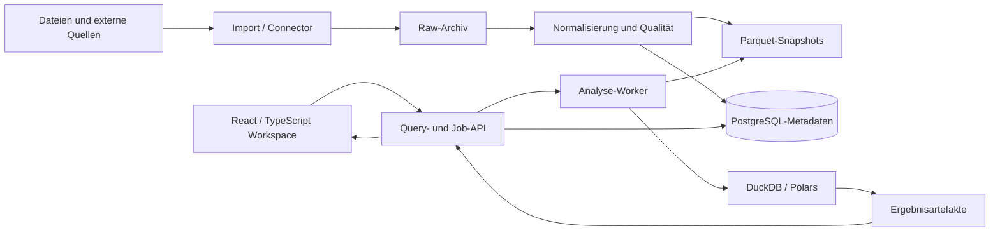

# 02 · Systemarchitektur

[Zur Übersicht](../README.md)

## 1. Architekturprinzipien

**Kontextfestlegung:** Historische Forschung zuerst; modularer Ausbau zur Live-Plattform. Speicherung, Berechnung und Darstellung bleiben getrennt. Raw-Daten werden durch Normalisierung nicht ersetzt. Große Analysen laufen außerhalb des Browsers.

**Vorschlag:** Ein modularer Python-Backendkern mit getrennten Prozessen für API, Import und Analyse ist der Ausgangspunkt. Modulgrenzen werden zunächst als Bibliotheksverträge umgesetzt. Eigene Netzwerkdienste entstehen erst, wenn Betrieb, Ausfallschutz oder Last dies rechtfertigen.



Das Diagramm zeigt logische Datenflüsse, keine abgeschlossenen verteilten Transaktionen. Das Commit-Protokoll für Dateien und Metadaten ist unten definiert.

## 2. Komponenten und Zuständigkeit

| Komponente | Zuständigkeit | Grenze |
|---|---|---|
| Connector | Abruf, Quellcursor, Rohpayload, Empfangszeit | Keine ungeprüfte fachliche Bereinigung |
| Normalizer | Einheiten, Instrumente, Zeiten, Schema, Qualitätsflags | Keine versteckte Ersetzung fehlender Werte |
| Catalog | Datensätze, Instrumente, Rechte, Schemata, Snapshots | Keine Vollablage aller historischen Candles in Metadatentabellen |
| Query Service | autorisierte und begrenzte Datensicht, Projektion, Filter | Kein beliebiges SQL aus dem Browser |
| Graph Planner | Typprüfung, DAG, Ressourcenabschätzung, Ausführungsplan | Keine Ausführung unvalidierter Plugins |
| Worker | reproduzierbare Berechnung, Fortschritt, Abbruch | Kein blockierender Job im API-Prozess |
| Artifact Store | Ergebnisse, Manifeste und referenzierte Dateien | Unveränderliche Inhalte unter versionierten IDs |
| Workspace Service | Graphversionen, Layout, Parameter, Run-Verweise | Layout ist keine Datenversion |
| Frontend | Datenbrowser, Canvas, Charts, Fehler und Provenienz | Keine autoritative Statistik auf heruntergesampelten Charts |

### Connector-Fähigkeiten

Die gemeinsame Metadatenschicht beschreibt Quelle, Schema, Datenarten, Zeit- und Revisionssemantik. Jeder Adapter deklariert versionierte Fähigkeiten:

| Feld | Bedeutung |
|---|---|
| `data_kinds` | Unterstützte Datenarten, etwa `candle`, `trade`, `order_book`, `funding`, `macro_observation`, `news_event` oder `onchain_transfer` |
| `historical_backfill` | Historische Daten abrufen oder importieren |
| `live_stream` | Kontinuierliche Updates liefern |
| `point_in_time` | Historische Veröffentlichungs- und Revisionsstände für deklarierte Reihen und Zeiträume belegen |
| `replay` | Einen aufgenommenen Eingabebestand deterministisch erneut abspielen |

Provider-spezifische Parser, Authentifizierung, Rate-Limits und Replay-Mechanik liegen in den Adaptern. Die Normalisierung bildet Rohdaten auf versionierte kanonische Schemata je Datenart ab. Der generische Katalog, die Abfrage und der Analyse-Executor verwenden diese Schemata und deklarierte Fähigkeiten. Historischer Import allein belegt keine historische Verfügbarkeit.

## 3. Technologieeinsatz

Python steuert Import, Geschäftslogik und statistische Module. Polars übernimmt tabellarische Transformationen; DuckDB dient SQL-Abfragen über den historischen Bestand. Verantwortlichkeiten pro Pipeline werden explizit gewählt, statt Daten bei jedem Node zwischen beiden Engines zu kopieren.

Parquet ist das geplante spaltenorientierte Austausch- und Archivformat für normalisierte Massendaten. PostgreSQL verwaltet Katalog, Arbeitsflächen, Jobstatus und Entscheidungen; es ist nicht automatisch das primäre Archiv für sämtliche historischen Datenpunkte.

Für DuckDB/Polars sind zeitliche Joins dokumentiert; sie ersetzen keine projektseitige Verfügbarkeitsprüfung. Siehe [DuckDB As-of-Joins](https://duckdb.org/docs/stable/sql/query_syntax/from) und [Polars Joins](https://docs.pola.rs/user-guide/transformations/joins/). Polars bietet eine [Lazy API](https://docs.pola.rs/user-guide/concepts/lazy-api/); die tatsächliche Speicherwirkung jedes geplanten Operators wird benchmarkbasiert geprüft.

**Vorschläge, noch offen:** Python-Webframework, konkreter Prozess-/Job-Runner, Chartbibliothek und Canvasbibliothek. React/TypeScript ist die Frontend-Richtung aus der Beauftragung. Eine Node.js-Laufzeit kann für Frontend-Werkzeuge verwendet werden, ist aber keine Voraussetzung für die Forschungsengine.

## 4. Speicherlayout und Veröffentlichung

```text
signal-atlas/                 # vorgeschlagene spätere Repository-Struktur
  apps/web/
  packages/backend/
  plugins/
  tests/fixtures/
  docs/
  data/                       # extern konfigurierbar; nicht in Git
    raw/<source>/<ingest-batch>/
    normalized/<dataset>/<schema-version>/<partition>/
    derived/<analysis>/<run-id>/
    manifests/<snapshot-id>.json
  workspaces/                 # optionale exportierte Arbeitsflächen
```

Partitionierung wird anhand AP 02/04 festgelegt: wahrscheinlich Quelle, Datentyp und Zeitbereich; Instrument nur bei ausreichender Dateigröße. Eine Datei pro Instrument und Minute erzeugt unnötig viele kleine Dateien. Zielgrößen für Dateien und Row Groups sind Benchmarkparameter, keine pauschalen Garantien.

**Vorschlag: atomare Sichtbarkeit über Manifest-Commit.**

Dateien und Manifest müssen vor dem PostgreSQL-Commit vollständig validiert und gemäß dem dokumentierten Haltbarkeitsvertrag des Speichers dauerhaft gesichert sein. Validierung umfasst die vollständige Dateiliste, Prüfsummen, Schemata, Zeilenzahlen und Qualitätsbericht; das Manifest bindet genau diese Inhalte. Ein bloß erfolgreicher Schreibaufruf oder Rename genügt nicht als Dauerhaftigkeitsnachweis. Erst danach darf PostgreSQL den Snapshot als `committed` sichtbar machen. Leser verwenden ausschließlich solche Snapshots und keine Staging-Pfade oder Dateiglobs. Bei fehlenden oder beschädigten referenzierten Inhalten wird die Abfrage ausdrücklich abgewiesen statt einen Teilbestand zu liefern.

Vom Beginn der Veröffentlichung bis zum abgeschlossenen Commit oder zur gesicherten Aufgabe schützt eine zwischen Publisher, Recovery und Garbage Collection koordinierte Veröffentlichungsreservierung sämtliche Dateien und das Manifest vor Löschung. Die konkrete Sperr-/Reservierungstechnik bleibt AP03 überlassen; sie muss exklusives Aufräumen gegen erneuten Commit absichern. Eine Schonfrist allein genügt nicht. Nach Ablauf einer Reservierung darf ein alter Publisher nicht mehr committen, ohne den Schutz erneut zu erwerben und Bestand, Dauerhaftigkeit und Validierung erneut zu prüfen. Bei Übernahme durch Recovery darf nur der aktuelle berechtigte Publisher abschließen.

Ein Absturz vor dem Commit lässt den Snapshot unsichtbar. Recovery setzt denselben Auftrag nur mit gültigem Schutz und erneut bestätigter Vollständigkeit fort oder gibt ihn koordiniert auf. Wiederholung nach unbekanntem Commit-Ausgang prüft zuerst den Katalog: derselbe Auftrag mit demselben Manifest liefert den bereits committed Snapshot, widersprechende Inhalte scheitern. Ein Absturz nach dem Commit hebt den Schutz durch die dauerhafte Katalogreferenz nicht auf. Verwaiste Dateien dürfen erst nach gesicherter Aufgabe, Ausschluss eines noch berechtigten Publishers und erneuter Referenzprüfung gelöscht werden; Retention und Backup gelten zusätzlich. Prüfung und Löschung sind mit Publishern koordiniert, sodass dazwischen kein Commit die Dateien referenzieren kann. Gemeinsam referenzierte Dateien bleiben erhalten.

Ein Dateisystem-Rename ist nur innerhalb seiner tatsächlichen atomaren Grenzen verwendbar; Objektablagen benötigen ein entsprechendes Commit-Verfahren. Eine PostgreSQL-Transaktion allein macht externe Dateien nicht atomar. Compaction erzeugt neue Snapshots; alte Runs behalten alte Dateireferenzen. Garbage Collection löscht nur unreferenzierte Daten außerhalb von Retention und Backup-Verpflichtungen.

## 5. Jobausführung und Parallelität

MVP-Vorschlag: PostgreSQL-basierte Jobtabelle mit transaktionalem Claim, Lease, Heartbeat und begrenzten Worker-Prozessen. Ein Prozessabsturz lässt die Lease auslaufen; ein Wiederholungsversuch erhält eine neue Attempt-ID. Kein Exactly-once-Versprechen: Ergebnisveröffentlichung und externe Effekte müssen idempotent sein. Der konkrete Runner ist D-04.

API-Prozesse nehmen Aufträge an und beantworten Statusabfragen. Analyse-Worker erhalten CPU-, RAM-, Laufzeit- und temporäre Speicherbudgets. Parallelität der Worker und Threads pro Engine werden gemeinsam begrenzt, damit mehrere DuckDB-/Polars-Jobs nicht alle Kerne und den Speicher mehrfach belegen.

Interaktive Aufträge bekommen eine getrennte, begrenzte Kapazität. Große Scans laufen als Hintergrundjobs; Abbruchsignale gelten zwischen Operatorschritten und bei unterstützten Engine-Abbrüchen. Ein nicht abbrechbarer Prozess wird nach einer Frist beendet, ohne halbe Ergebnisse als erfolgreich zu markieren.

## 6. Live-Ausbau

```text
Quelle → persistente Aufnahme → Normalisierung → Live-Projektion / Benachrichtigung
                                      └──────→ gebündelter Historical Writer
```

Ein Live-Ereignis wird erst nach dauerhafter Aufnahme bestätigt. Replay und mindestens einmalige Zustellung werden als Normalfall behandelt. Schlüssel, Cursor und Sequenznummern ermöglichen Deduplikation und Wiederaufnahme. Orderbücher benötigen Snapshot plus geordnete Deltas; Sequenzlücken machen den Zustand ungültig bis zum Neuaufbau.

Späte Ereignisse und Korrekturen erzeugen neue Revisionen. Watermarks kennzeichnen erwartete Vollständigkeit, nicht absolute Fehlerfreiheit. Der Übergang zwischen Live-Sicht und historischem Snapshot erfolgt über einen expliziten Cutover-Cursor; nachgelagerte Leser deduplizieren die Überlappungszone.

**Optionen:** NATS JetStream als persistenter Ereignisstrom, TimescaleDB für operative Zeitreihen, ClickHouse bei nachgewiesener Tick-/Orderbuchlast. Keine dieser Optionen ist eine MVP-Abhängigkeit. Auswahl erst mit Lastprofil, Betriebsaufwand und Wiederherstellungstest.

Die [Plugin-Freigabe](adr/0006-plugin-vertrauen.md) bindet Plugin-ID, Implementierungsversion und unveränderlichen Code-/Paketnachweis. Loader prüfen genau diese freigegebenen Inhalte; Änderungen erfordern erneute Prüfung. Fehlt die gebundene Version für einen alten Run, scheitert dessen Ausführung ausdrücklich ohne Versionsfallback.

## 7. Native Beschleunigung und Deployment

Rust/C++ sind optionale Beschleuniger nach Profiling. Vorher: Filter früh anwenden, unnötige Kopien entfernen, Algorithmen verbessern, geeignete Partitionierung und Caching prüfen. Native Module bekommen denselben fachlichen Vertrag wie Python-Referenzen, Tests gegen Referenzergebnisse und dokumentierte Build-/ABI-Unterstützung.

**Bestätigter MVP-Rahmen (ADR-0001):** Lokales Deployment mit Weboberfläche, API, PostgreSQL und wenigen Workern. Vorgeschlagen ist ein späteres Compose-Profil; Containerdateien existieren in diesem Dokumentationspaket nicht. Öffentliches Hosting erfordert Authentifizierung, TLS, Rollen, Quoten und ein separates Betriebsmodell. Kubernetes und verteilte Ausführung sind offen und für v0.1 nicht vorgesehen.

## 8. AP01-Konkretisierung

Der [AP01-Vertrag](08-ap01-contract.md) konkretisiert beide Research-Abläufe, Schnittstellen, Modulgrenzen, numerische Toleranzen und die Übergabe. Technische ADRs sind Vorschläge zur Abnahme. Softwaretests und Benchmarks werden erst in den nachfolgenden Arbeitspaketen ausgeführt.
